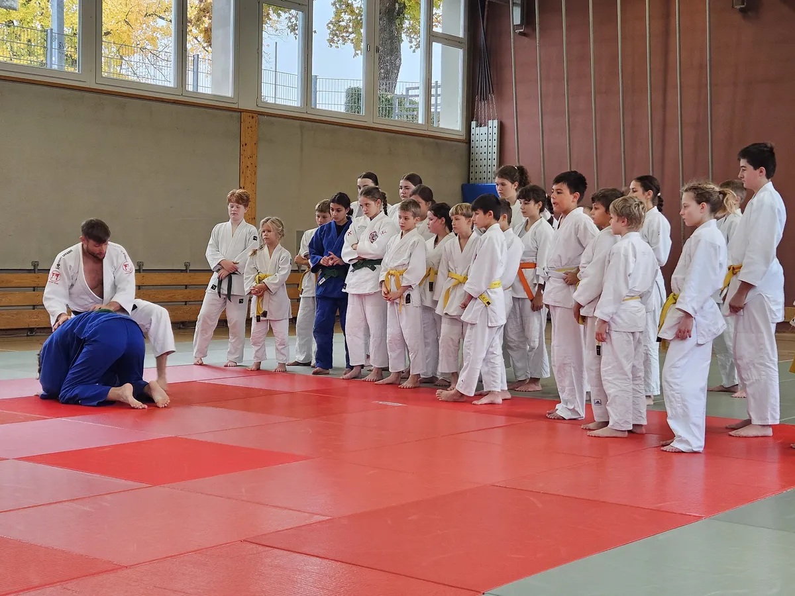
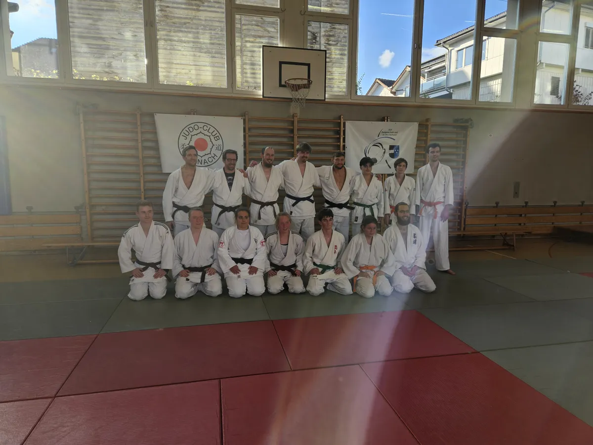

Am Samstag, 31. Oktober 2026, fanden in Reinach zwei Judo-Spezialtrainings mit dem Weltmeister Nils Stump statt.

Am Vormittag standen die Kinder im Mittelpunkt. 25 junge Judokas nutzten die Gelegenheit, mit dem erfolgreichen Schweizer Judoka zu trainieren. Nach einem gemeinsamen Aufwärmen wurde zunächst eine Drehtechnik aus der Bankposition geübt. Einige Bodenrandoris sorgten zwischendurch für Abwechslung. Anschliessend wurde die Wurftechnik Tai-otoshi Schritt für Schritt aufgebaut und zum Abschluss in verschiedenen Standrandoris angewendet. Natürlich durften nach dem Training Autogramme und gemeinsame Fotos mit Nils nicht fehlen.

Am Nachmittag waren 15 Jugendliche und Erwachsene auf der Matte. Sie beschäftigten sich mit denselben Techniken wie am Vormittag, allerdings in anspruchsvolleren Varianten für Fortgeschrittene.

Ein rundum gelungener Trainingstag mit vielen wertvollen Tipps, neuen Inputs und der besonderen Gelegenheit, direkt von einem Weltmeister zu lernen. Ein herzliches Dankeschön an Nils Stump für die spannenden Trainings!
